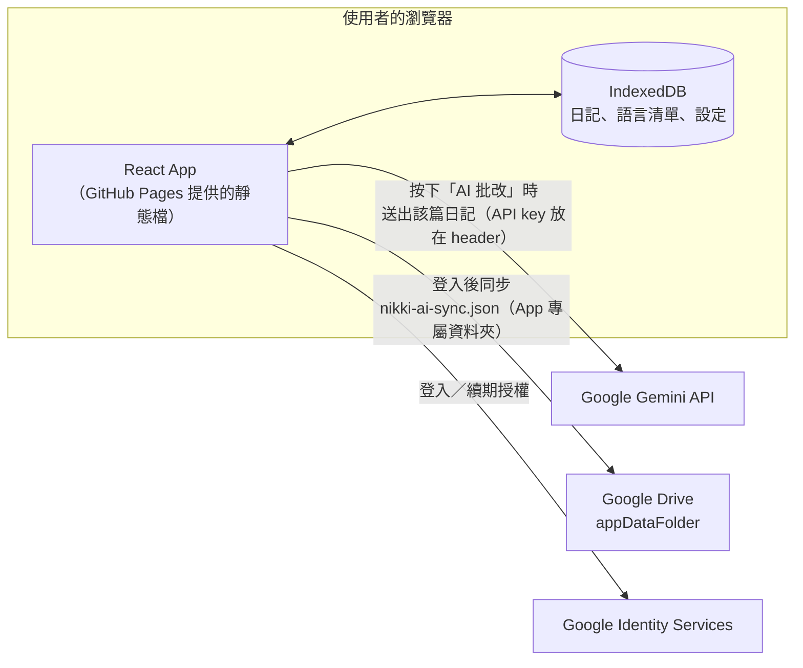

# 外語學習日記

讓外語學習者用外語寫日記，並用 AI（Gemini）批改：找出文法錯誤、不通順的句子，推薦更道地的說法。

- 純前端網頁應用，沒有後端服務。
- 日記存在你的瀏覽器（IndexedDB）裡；登入 Google 後也會同步到你 Google Drive 中只有這個 App 看得到的資料夾。只有在你按「AI 批改」時，那篇日記的內容才會送到 Google Gemini。

## 目前功能（Phase 4）

- 新增、編輯、刪除日記：選擇日期（預設今天，最晚只能選到今天），用任何外語輸入純文字內容；一天可以寫好幾篇。
- 日記列表依日期排序，日期新的在上；同一天內，後寫的在上。
- 日曆：主畫面的日曆標出有寫日記的日子（已刪除的不算），可切換月份或按「今天」回到本月；點有日記的日期，列表只顯示當天的日記，再點一次或按「顯示全部」回到完整列表。寬螢幕時日曆在列表左邊，手機上在上方。
- 刪除前會先確認。刪除採軟刪除，內文會立即清除。
- 第一次開啟時顯示使用說明頁，用一篇範例日記示範 AI 批改結果的樣子。之後可從畫面右上角的「？」（使用說明）重新打開。
- 日記語言：自動判斷（預設）、日文、英文，或選「其他」自行輸入；自行輸入過的語言會加入語言清單，之後可直接選擇。
- AI 批改：在日記頁按「AI 批改」，顯示文法錯誤、不通順的句子、更道地的說法、修改後全文（修改處粗體）與中文翻譯。批改結果會儲存，不會修改日記原文；寬螢幕左右並排，手機上下排列。
- 設定頁（畫面右上角的齒輪）：輸入、修改、刪除自己的 Gemini API key（附申請說明）；選擇 Gemini 模型（預設自動選最新的 Flash 模型）；刪除語言清單中的語言。
- 跨裝置同步：在設定頁登入 Google 後，日記、語言清單、Gemini API key 與模型會自動同步（開啟 App、資料變動後、網路恢復時，或按「立即同步」）。頂部列的雲朵圖示顯示同步狀態。登出只停止同步，不會刪除任何資料。若 Google Drive 上的同步資料無法讀取（例如由較新版本的 App 寫入），同步會暫停，避免覆蓋資料。

## 部署網址

https://ericcheng09.github.io/nikki-ai/

`main` 分支更新後，GitHub Actions 會自動執行單元測試、build 與 E2E 測試；全部通過才部署到 GitHub Pages。

repo 的 Pages 來源需設定為「GitHub Actions」，這是一次性的設定。

## 技術選型

| 項目 | 選擇 |
|---|---|
| 前端框架 | React |
| 建置工具 | Vite |
| 套件管理 | npm |
| 本機儲存 | IndexedDB |
| 單元測試 | Vitest |
| E2E 測試 | Playwright |
| 部署 | GitHub Actions + GitHub Pages |
| AI | Gemini API（Phase 2 起，使用者自備 API key） |
| 跨裝置同步 | Google Drive（`drive.appdata`） |
| 認證 | Google 登入（Google Identity Services） |

## 系統架構

全部在瀏覽器內執行，沒有自己的後端伺服器。



- **本機優先**：不登入也能使用全部功能，資料存在 IndexedDB。
- **AI 批改**：使用者自備 Gemini API key，只有按下「AI 批改」時才送出那篇日記。
- **同步**：登入 Google 後，日記、語言清單、API key 與模型存成一個 JSON 檔，放在 Drive 中只有這個 App 看得到的資料夾。

## 開發流程

以 AI 代理分工模擬小型開發團隊，由開發者本人擔任決策者。流程定義在 [docs/WORKFLOW.md](docs/WORKFLOW.md)。

| 角色 | 工作 |
|---|---|
| 開發者本人 | 確認每個 phase 的計畫、所有規格決策、閱讀 review 標出的重點、決定是否合併到 `main` |
| Planner | 拆解任務與完成條件、分派、轉交問題；規格不清時停下來詢問 |
| Developer | 實作與單元測試、commit |
| Tester | E2E 與驗收測試 |
| Code Reviewer | 每個任務 review、每個 phase 寫 summary |

- 每個 phase 從 `main` 開 `dev/phase-<編號>` 分支；一個任務一個 commit，review 修正併入原 commit；phase 結束以一般 merge 合併。
- 核心邏輯（排序、軟刪除、JSON 驗證、日曆標示、同步合併與清除）以 TDD 撰寫。
- E2E 中 Gemini、Google 登入與 Drive 一律模擬；任何未模擬的外部請求會讓測試失敗。
- `main` 更新後，GitHub Actions 執行單元測試、build 與對正式 build 的 E2E，全部通過才部署。
- 規格沒寫到的細節記錄在 [docs/decisions.md](docs/decisions.md)，經開發者本人確認。

## 關鍵設計決定

| 決定 | 理由 |
|---|---|
| 純前端，不建後端 | 免費、不用管伺服器與帳號；日記留在使用者自己手上 |
| 使用者自備 Gemini API key | 完全免費、不需要中間層；key 只存在使用者自己的瀏覽器與 Drive |
| 用 Google Drive 的 App 專屬資料夾同步 | 免費、不需要後端；`drive.appdata` 只看得到 App 自己的資料，不碰使用者其他檔案 |
| 從 Phase 1 就採軟刪除 | 多裝置同步時，直接刪除的資料會被另一台「同步回來」；保留刪除記號才能正確同步 |
| 範例日記改成首次使用說明頁，不存成日記 | 範例若是日記，就需要特殊欄位與刪除例外，日曆和同步也要另外排除；做成說明頁，資料模型不需要任何例外 |
| 自訂語言做成可同步的清單，最後一個動作為準 | 不用每篇重打；每個語言一筆資料，和日記用同一套合併規則，刪除與加回都能正確同步 |
| 模型不寫死，查詢可用模型、預設選最新的正式版 Flash | Google 會推出與下架模型，寫死遲早要改程式；只列正式版，避免預覽版突然變動 |
| Gemini API 網址寫死 | key 只能送到 Gemini；網址寫死，key 就不可能被設定成送到別的地方 |
| 日曆的選取記在網址 | 重新整理或返回頁面都能保留選取，日曆與列表讀同一份狀態 |
| 同步資料存成單一 JSON 檔 | 一次同步只要少數幾個請求，合併邏輯簡單；日記是純文字，檔案不大 |

## 本機安裝與執行

需要 Node.js 22。

```bash
npm ci            # 安裝套件
npm run dev       # 開發伺服器：http://localhost:5173/nikki-ai/
npm run build     # 建置正式版到 dist/（含給 GitHub Pages 用的 404.html）
npm run preview   # 預覽正式版：http://localhost:4173/nikki-ai/
```

> 注意：如果用 `npm run dev -- --host` 讓手機透過區網 IP（例如 `http://192.168.x.x:5173/nikki-ai/`）連線，瀏覽器的安全限制會讓新增日記失敗，請用 `localhost` 開啟。正式網址是 HTTPS，不受影響。

> Google 登入只能在已登記的網址使用（正式網址與 `http://localhost:5173`）；用區域網路 IP 從手機連線時無法登入。目前 OAuth 為「測試」狀態，只有加入測試使用者的 Google 帳號可以登入。

## 測試

第一次執行 E2E 測試前，先安裝 Playwright 使用的瀏覽器：

```bash
npx playwright install chromium
```

| 指令 | 說明 |
|---|---|
| `npm test` | 單元測試（Vitest），固定在 `Asia/Taipei` 時區執行 |
| `npm run test:e2e` | E2E 測試，對開發伺服器執行（port 5199）；部署專用的測試會略過 |
| `npm run test:e2e:prod` | 先 build，再對模擬 GitHub Pages 的本機伺服器執行完整 E2E 測試 |

## 文件

- [docs/spec.md](docs/spec.md)：正式規格
- [docs/decisions.md](docs/decisions.md)：開發過程中確定的細節決定
- [docs/WORKFLOW.md](docs/WORKFLOW.md)：開發流程與角色分工
- Phase summary：[Phase 1](docs/phases/phase-1-summary.md)、[Phase 2](docs/phases/phase-2-summary.md)、[Phase 3](docs/phases/phase-3-summary.md)、[Phase 4](docs/phases/phase-4-summary.md)
